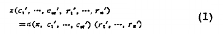
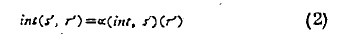

# UTEM: the first Futamura projection, alongside the implementation

*Machine-generated reading guide. Source checked against `heartpunk/utem` at `88efa92e1fe4c0553f8eba43dec198b19ebdeb31`, the GitHub main revision on 18 October 2026. Listings below are excerpts from that revision, not proposed replacements.*

UTEM contains an implemented reference specializer and a Lean proof of its behavioral correspondence. It binds fixed code into a residual AYXG transition system and its initializer. The remaining input is supplied afterward. The useful distinction is between what is already established—this construction and its semantic correctness—and what we still need to see in practice: extracted interpreters, concrete programs, and useful specialization. The repository records a successful build and axiom audit of the implementation.[^build]

## 1. Partial evaluation: fix some inputs, leave the others open

Futamura's original definition separates fixed inputs from remaining inputs. Evaluating the specialized computation on the remaining inputs gives the same result as evaluating the original computation on both groups. Equation (1), on printed page 46:[^paper]



**Typeset transcription of the scan:**

$$
\begin{aligned}
&\pi\!\left(c_1^{\prime},\ldots,c_m^{\prime},\,r_1^{\prime},\ldots,r_n^{\prime}\right)\\
&\quad=\alpha\!\left(\pi,c_1^{\prime},\ldots,c_m^{\prime}\right)
  \!\left(r_1^{\prime},\ldots,r_n^{\prime}\right)
\end{aligned}
\tag{1}
$$

Here the first symbol is Greek $$\pi$$, naming the original computation; $$\alpha$$ names the partial evaluator. The primes mark supplied values, not derivatives. The final parentheses apply the specialized computation to the remaining inputs.

UTEM makes that separation explicit in its types:[^interface]

```lean
abbrev System (Γ : Ctx) (Edge : Type) :=
  SymbolicTransitionSystem Unit Γ Edge
```

```lean
structure Residual (Γres Γinput : Ctx) (ResidualEdge : Type) where
  system : System Γres ResidualEdge
  entry : StateUpdate Γinput Γres
```

```lean
abbrev Project (Code SourceEdge ResidualEdge : Type) (Γsrc Γres Γinput : Ctx) :=
  Code → System Γsrc SourceEdge → Residual Γres Γinput ResidualEdge
```

The projector receives **code and an STS**. It returns **an STS and typed initialization syntax**. That initializer takes only the remaining input environment; there is no second code argument at execution time. The separate control parameter is `Unit`: modeled control state belongs in the symbolic environment.

The loading operation and observation interface are explicit parts of the specification, rather than conventions hidden in the theorem:[^interface]

```lean
structure ProjectionSpec (Code SourceEdge ResidualEdge : Type)
    (Γsrc Γres Γinput : Ctx) where
  Effect : Type
  Result : Type
  sourceEntry : Code → StateUpdate Γinput Γsrc
  admissible : Code → Expr Γinput .bool
  sourceObservations : Observations Γsrc SourceEdge Effect Result
  residualObservations : Observations Γres ResidualEdge Effect Result
```

Here, `sourceEntry code` loads the fixed code together with the remaining input. `admissible` states the allowed input domain. `Effect` and `Result`, with their observation functions, say which behavior the correspondence must preserve. The declarations use AYXG's existing `FPInterpretation` parameter for floating-point semantics.

## 2. The first projection: specialize the interpreter for a program

Futamura then applies partial evaluation to an interpreter, fixing its source-program input. Equation (2), on the same page:[^paper]



**Typeset transcription of the scan:**

$$
\mathit{int}\!\left(s^{\prime},r^{\prime}\right)
=\alpha\!\left(\mathit{int},s^{\prime}\right)\!\left(r^{\prime}\right)
\tag{2}
$$

Here $$s^{\prime}$$ is the fixed source program and $$r^{\prime}$$ is the remaining input. The right-hand side first specializes the interpreter for $$s^{\prime}$$, then applies the resulting computation to $$r^{\prime}$$.

| In the paper | In this implementation |
| --- | --- |
| `int`, the interpreter | `source : Sketch.System Γ E` |
| `s′`, the fixed program | `code : Code`, loaded by `sourceEntry code` |
| `r′`, the remaining input | `input : Env Γinput` |
| `α(int, s′)`, the specialized computation | `project budget cells sourceEntry code source` |
| Applying it to `r′` | Initialize the returned STS with `residual.entry.eval input` |

The argument order differs; the roles do not. When `source` models an interpreter and `code` is its program, this is the first-projection application of the more general specializer.

This is the actual constructor—not merely the type of a desired implementation:[^project]

```lean
def project (budget : Nat) (cells : Tracked Γ)
    (sourceEntry : Code → StateUpdate Γinput Γ) :
    Sketch.Project Code E (CompiledEdge budget Γ E) Γ (ResidualCtx budget Γ) Γinput :=
  fun code source =>
    let entry := sourceEntry code
    let table := buildContexts budget cells source entry
    { system := compiledSystem cells table source, entry := taggedEntry budget entry }
```

`cells` selects the scalar variables and fixed memory addresses whose values the specializer tracks. `budget` bounds discovery of specialized contexts. The constructor binds the code, discovers facts from that initialization, and emits a residual graph. If discovery cannot supply a specialized successor context, execution falls back to an unspecialized context with the complete state intact.[^contexts]

## 3. Where the specialization actually happens

The residual contains rewritten guards and updates. This is the point where known facts change the transition syntax:[^graph]

```lean
def compileLabel (facts : Facts Γ) (current target : Index budget) (label : SymbolicLabel Γ) :
    SymbolicLabel (ResidualCtx budget Γ) where
  guard := .boolAnd (tagGuard current)
    ((specialize facts label.guard).val.weaken (tagDecl budget))
  update := taggedUpdate target (specializeUpdate facts label.update).val
```

Graph emission also removes edges whose guards specialize to false. Each retained edge stores its materialized label; residual execution reads that label rather than calling the specializer again.[^graph]

This implementation retains the complete source state and adds a context tag. It specializes expressions and branches, but it preserves source-step granularity. **The established result is a semantics-preserving reference specializer; it does not yet establish general interpreter elimination or a speedup.** Those are distinct from the first-projection result equation. Futamura also treats the effectiveness of partial evaluation separately from that equation.[^limitations][^paper]

## 4. The behavioral equation, stated for this implementation

Here is the concrete theorem corresponding to equation (2), including its full statement and existing proof term:[^equation]

```lean
theorem first_futamura_equation (budget : Nat) (cells : Tracked Γ)
    (sourceEntry : Code → StateUpdate Γinput Γ)
    (admissible : Code → Expr Γinput .bool)
    (observations : Sketch.Observations Γ E Effect Result) (code : Code)
    (source : Sketch.System Γ E) (input : Env Γinput)
    (allowed : Eval.evalBool input (admissible code) = true)
    (effects : List Effect) (result : Result) :
    Returns (Sketch.residualSystem (specification budget sourceEntry admissible observations)
        (project budget cells sourceEntry code source))
      (some ⟨(), (project budget cells sourceEntry code source).entry.eval input⟩) effects result ↔
    Returns (Sketch.sourceSystem (specification budget sourceEntry admissible observations) code source)
      (some ⟨(), (sourceEntry code).eval input⟩) effects result :=
  (referenceProjector budget cells sourceEntry admissible observations).first_futamura_equation
    code source input allowed effects result
```

Read the two sides of `↔` as:

| Specialized execution | Original execution |
| --- | --- |
| Execute the STS returned by `project … code source`. | Execute `source`. |
| Initialize it with the remaining `input`. | Initialize it with `code` and the same `input`. |
| Produce `effects` and return `result`. | Produce the same `effects` and return the same `result`. |

`Returns` means a finite trace of those effects followed by an explicit returned-result observation. It is not simply reaching a state with no outgoing transitions.[^behavior]

The underlying contract additionally requires forward and backward weak-step correspondence and preservation **and reflection** of infinite silent execution. Internal steps may disappear under that contract; this reference construction establishes the stronger step-for-step correspondence and derives the weak version from it.[^behavior][^steps]

## 5. Why this is a proof about the implementation, not assumed correctness

The concrete theorem constructs its relation and proves the obligations. There is no argument supplying a correctness certificate for `project`:[^correct]

```lean
theorem project_correct (budget : Nat) (cells : Tracked Γ)
    (sourceEntry : Code → StateUpdate Γinput Γ)
    (admissible : Code → Expr Γinput .bool)
    (observations : Sketch.Observations Γ E Effect Result) (code : Code)
    (source : Sketch.System Γ E) :
    ∃ R, Sketch.ProjectionCorrect (specification budget sourceEntry admissible observations)
      code source (project budget cells sourceEntry code source) R := by
  let table := buildContexts budget cells source (sourceEntry code)
  let strong := observed_strong cells table source (sourceEntry code) observations
  refine ⟨ViewRel table, ?_⟩
  constructor
  · intro input _allowed
    apply ViewRel.active
    refine ⟨entryIndex budget, ?_, ?_⟩
    · exact taggedEntry_eval budget (sourceEntry code) input
    · rw [buildContexts_entry]
      exact seed_correct (sourceEntry code) cells input
  · exact strong.weak.forward
  · exact strong.weak.backward
  · exact strong.weak.divergence
```

The active-state relation is concrete: the residual environment is the source environment with a tag attached, and the facts associated with that tag hold.[^relation]

```lean
def StateRel (table : ContextTable Γ budget)
    (s : Config Unit Γ) (r : Config Unit (ResidualCtx budget Γ)) : Prop :=
  ∃ current, r.env = tagged current s.env ∧ Holds (table.get current) s.env
```

The residual observation functions are likewise derived from the original ones by erasing the added tag and retaining each edge's source origin:[^observations]

```lean
def liftedObservations (observations : Sketch.Observations Γ E Effect Result) :
    Sketch.Observations (ResidualCtx budget Γ) (CompiledEdge budget Γ E) Effect Result where
  effect := fun s edge t => observations.effect (eraseConfig s) edge.origin (eraseConfig t)
  result := fun s => observations.result (eraseConfig s)
```

Consequently, the implementation does not establish correspondence by choosing an unrelated residual meaning. `graph_forward` and `graph_backward` match transitions while preserving the complete source state and edge origin; `observed_strong` carries that correspondence through to the specified effects and results.[^steps][^observations]

`referenceProjector` subsequently packages this constructor with this proved theorem. That packaging is downstream of the implementation and proof, not a substitute for either.[^correct]

## 6. Where WRUH enters, and what remains

The existing `projected_wruh_bisimilar` theorem applies this same implemented projector to `Wruh.FreshExtraction.extract A binary` and relates the result to `A.reference binary`. Its extraction-side premise is explicitly `laws : Wruh.FreshExtraction.SymexLaws A`. The specialization side uses the proved implementation above. The theorem is already present; a concrete demo does not require inventing another projector-correctness proof.[^wruh]

**Current status:** the implemented projector and its proofs have recorded successful Lean checks. Model reviews and a basic human correspondence pass have happened; deeper human review and concrete end-to-end examples remain. This walkthrough explains the declarations and their relationship. It does not report a completed TMVM projection run or measured performance improvement.

**TODO — reproducible TMVM demonstration, with no new proofs:**

- Build TMVM at the canonical XYBS mainline pin.
- Extract the interpreter with WRUH.
- Specialize that extracted interpreter with several fixed TMVM programs using UTEM.
- Show the residual programs' behavior beside the original interpreter's behavior on the same remaining inputs.
- Package those steps as one reproducible target and record the revisions and outputs.

**TODO — follow-up review:** review the statement and implementation more thoroughly, fold this explanation into the UTEM documentation, and use the concrete examples to decide subsequent implementation priorities.

---

## Sources and exact code locations

All UTEM links below are pinned to commit `88efa92e1fe4c0553f8eba43dec198b19ebdeb31` in `heartpunk/utem`. The repository's build evidence identifies the implementation commit as `826993257f621374ec7d349406e8a64251e1a0d3`; the subsequent commit only adds its evidence locator. These links require repository access while UTEM remains private.

[^paper]: Yoshihiko Futamura, *Partial Evaluation of Computation Process—An Approach to a Compiler-Compiler* (1971), [original paper, printed p. 46, §§2–3 and equations (1)–(2), PDF page 2](https://fi.ftmr.info/PE-Museum/PE-Original-English1971.pdf#page=2). Printed p. 47 discusses effectiveness properties separately. The images above reproduce only the two equations.

[^interface]: `heartpunk/utem`, pinned revision above: [`FirstFutamura.lean`, `System`, `ProjectionSpec`, and `Residual`, lines 31–57](https://github.com/heartpunk/utem/blob/88efa92e1fe4c0553f8eba43dec198b19ebdeb31/FirstFutamura.lean#L31-L57); [`Project`, lines 99–101](https://github.com/heartpunk/utem/blob/88efa92e1fe4c0553f8eba43dec198b19ebdeb31/FirstFutamura.lean#L99-L101).

[^project]: `heartpunk/utem`, pinned revision above: [`Reference/Projector.lean`, `project`, lines 55–63](https://github.com/heartpunk/utem/blob/88efa92e1fe4c0553f8eba43dec198b19ebdeb31/Reference/Projector.lean#L55-L63).

[^contexts]: `heartpunk/utem`, pinned revision above: [`Reference/Contexts.lean`, `discover`, `buildContexts`, and `chooseTarget`, lines 18–62](https://github.com/heartpunk/utem/blob/88efa92e1fe4c0553f8eba43dec198b19ebdeb31/Reference/Contexts.lean#L18-L62).

[^graph]: `heartpunk/utem`, pinned revision above: [`Reference/Graph.lean`, `CompiledEdge`, `compileLabel`, and `keepEdge`, lines 7–32](https://github.com/heartpunk/utem/blob/88efa92e1fe4c0553f8eba43dec198b19ebdeb31/Reference/Graph.lean#L7-L32); [`emitEdges`, `compiledSemantics`, and `compiledSystem`, lines 42–62](https://github.com/heartpunk/utem/blob/88efa92e1fe4c0553f8eba43dec198b19ebdeb31/Reference/Graph.lean#L42-L62).

[^limitations]: `heartpunk/utem`, pinned revision above: [`docs/reference-implementation.md`, reference limitations, lines 38–58](https://github.com/heartpunk/utem/blob/88efa92e1fe4c0553f8eba43dec198b19ebdeb31/docs/reference-implementation.md#L38-L58). These also document conservative simplification choices and potentially expensive traversal of shared expressions; there is no claimed polynomial runtime bound.

[^equation]: `heartpunk/utem`, pinned revision above: [`Reference/Projector.lean`, `first_futamura_equation`, lines 111–126](https://github.com/heartpunk/utem/blob/88efa92e1fe4c0553f8eba43dec198b19ebdeb31/Reference/Projector.lean#L111-L126).

[^behavior]: `heartpunk/utem`, pinned revision above: [`FirstFutamura.lean`, `ProjectionCorrect`, lines 77–97](https://github.com/heartpunk/utem/blob/88efa92e1fe4c0553f8eba43dec198b19ebdeb31/FirstFutamura.lean#L77-L97); [`FutamuraCore.lean`, `WeakStep`, `Diverges`, and `WeakBisimulation`, lines 25–47](https://github.com/heartpunk/utem/blob/88efa92e1fe4c0553f8eba43dec198b19ebdeb31/FutamuraCore.lean#L25-L47); [`ViewedStep` and `Returns`, lines 210–238](https://github.com/heartpunk/utem/blob/88efa92e1fe4c0553f8eba43dec198b19ebdeb31/FutamuraCore.lean#L210-L238).

[^correct]: `heartpunk/utem`, pinned revision above: [`Reference/Projector.lean`, `project_correct` and `referenceProjector`, lines 78–109](https://github.com/heartpunk/utem/blob/88efa92e1fe4c0553f8eba43dec198b19ebdeb31/Reference/Projector.lean#L78-L109).

[^relation]: `heartpunk/utem`, pinned revision above: [`Reference/Graph.lean`, `eraseConfig`, `StateRel`, and `StateRel.erase`, lines 97–111](https://github.com/heartpunk/utem/blob/88efa92e1fe4c0553f8eba43dec198b19ebdeb31/Reference/Graph.lean#L97-L111).

[^observations]: `heartpunk/utem`, pinned revision above: [`Reference/Projector.lean`, `liftedObservations`, `ViewRel`, and `observed_strong`, lines 8–53](https://github.com/heartpunk/utem/blob/88efa92e1fe4c0553f8eba43dec198b19ebdeb31/Reference/Projector.lean#L8-L53); [`specification`, lines 65–76](https://github.com/heartpunk/utem/blob/88efa92e1fe4c0553f8eba43dec198b19ebdeb31/Reference/Projector.lean#L65-L76).

[^steps]: `heartpunk/utem`, pinned revision above: [`Reference/GraphCorrect.lean`, `graph_forward` and `graph_backward`, lines 7–63](https://github.com/heartpunk/utem/blob/88efa92e1fe4c0553f8eba43dec198b19ebdeb31/Reference/GraphCorrect.lean#L7-L63); [`Reference/Strong.lean`, `StrongBisimulation.weak`, lines 28–41](https://github.com/heartpunk/utem/blob/88efa92e1fe4c0553f8eba43dec198b19ebdeb31/Reference/Strong.lean#L28-L41).

[^wruh]: `heartpunk/utem`, pinned revision above: [`Reference/Projector.lean`, `projected_wruh_bisimilar`, lines 134–155](https://github.com/heartpunk/utem/blob/88efa92e1fe4c0553f8eba43dec198b19ebdeb31/Reference/Projector.lean#L134-L155).

[^build]: `heartpunk/utem`, pinned revision above: [`evidence/2026-10-17/reference/package-check.log`, successful build at line 221 and reference theorem axiom audit at lines 264–270](https://github.com/heartpunk/utem/blob/88efa92e1fe4c0553f8eba43dec198b19ebdeb31/evidence/2026-10-17/reference/package-check.log#L221-L270). The audited reference theorems report `propext`, `Classical.choice`, and `Quot.sound`, with no `sorryAx`. [`implementation-revision.txt`, lines 1–9](https://github.com/heartpunk/utem/blob/88efa92e1fe4c0553f8eba43dec198b19ebdeb31/evidence/2026-10-17/reference/implementation-revision.txt#L1-L9) identifies the checked implementation. This guide cites that recorded build; it does not claim a fresh successful rerun.